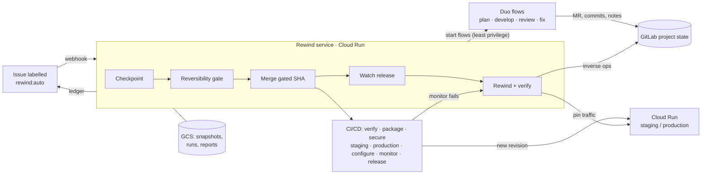

# ⏪ Rewind — Ctrl+Z for autonomous software delivery

Agents can now take an issue all the way to production on GitLab. But when an agent gets it
wrong at 2 a.m., there is no undo for *what the agent did*: the merge, the flag it switched
on, the release it cut, the revision it deployed.

**Rewind lets agents do anything it can undo, and stops them only for what it can't.**
Autonomy is set by reversibility, not by a fixed approval level.

- **Checkpoint**: before Duo flows act, Rewind snapshots everything they can touch: code,
  merge requests, issues, labels, feature flags, CI/CD variables (fingerprints only), tags,
  releases, and which Cloud Run revision serves each environment.
- **Gate**: before merge, every change is classified as *reversible*, *compensatable* or
  *irreversible*. Undoable work ships hands-off. Anything that can't be undone (an email
  sent, a migration with no downgrade, an agent editing its own guardrails) is blocked or
  rerouted behind a feature flag.
- **Rewind**: if production regresses, Rewind undoes the agent's whole change set in
  mitigation order. Traffic and flags go first (seconds), then code, then the paper trail.
  It then **verifies zero drift** against the checkpoint, and the rewind can itself be undone.

> The demo: an agent ships a pricing promo to production hands-off, monitoring catches
> negative prices, and the merge, the flag, the deploy and the issue state all go back to the
> checkpoint. Traffic recovers in seconds, verified with zero drift.

## Who it's for

Platform and DevEx teams at GitLab Premium/Ultimate companies who want to give agents more
autonomy but can't accept irreversible mistakes. The pitch is concrete: **more autonomy, same risk.**

## Architecture



Rewind runs **outside** the agents. It works through GitLab's public APIs and Cloud Run's
Admin API, so it doesn't depend on any experimental agent feature to undo what agents did.

| Piece | Where |
|---|---|
| Engine: snapshot, diff, classify, inverse ops, verify | [`rewind/`](rewind/) · [`rewind/resources/`](rewind/resources/) |
| Reversibility policy | [`rewind/policy.yaml`](rewind/policy.yaml) |
| Gate (runs on the MR before merge) | [`rewind/gate.py`](rewind/gate.py) |
| Hands-off orchestrator (durable state machine) | [`service/orchestrator.py`](service/orchestrator.py) |
| Dashboard, webhooks, MCP server | [`service/`](service/) |
| Duo custom flows and agent | [`flows/`](flows/) · [`agents/`](agents/) · [`.gitlab/duo/`](.gitlab/duo/) · [`AGENTS.md`](AGENTS.md) |
| Demo app the agents change | [`app/`](app/) |
| Pipeline | [`.gitlab-ci.yml`](.gitlab-ci.yml) · [`ci/`](ci/) |
| **Google Cloud deployment code** | [`infra/gcp-setup.sh`](infra/gcp-setup.sh) · [`infra/deploy-rewind.sh`](infra/deploy-rewind.sh) · [`ci/deploy_cloud_run.sh`](ci/deploy_cloud_run.sh) |

## How the hands-off loop works

1. **Trigger**: label an issue `rewind:auto`. The webhook reaches Rewind, which serializes runs per project so every change set is attributable.
2. **Checkpoint**: snapshot the project and the serving Cloud Run revisions. The ID goes on the issue and the MR.
3. **Plan**: the custom planner flow ([`flows/rewind_planner.yml`](flows/rewind_planner.yml)) posts a plan that classifies every step by reversibility.
4. **Develop**: the developer flow opens an MR. It gets only the privileges the policy allows for that step, all pre-approved, so it never stalls waiting on a human.
5. **Gate**: Rewind diffs the project against the checkpoint and checks the MR's code.
   - *allow*: everything is undoable.
   - *reroute*: e.g. the live pricing path was changed, so the agent is told to move it behind the flag. Then it's gated again.
   - *block*: e.g. new code calls an external service. The run stops for a human.
6. **Verify and review**: the MR pipeline runs tests, SAST, dependency, secret and container scanning. If it fails, the fix-pipeline flow gets bounded attempts, and every new commit is gated again. Duo code review follows.
7. **Merge**: Rewind merges with `sha=<gated head>`, so a commit the gate never saw can't slip in.
8. **Release**: package → staging (deploy, apply flags, smoke) → production → `configure` (apply `config/flags.yaml`) → `monitor` (3 minutes of synthetic traffic plus business invariants) → GitLab release.
9. **Rewind**: if anything fails after merge, Rewind undoes the change set:

   | Order | Inverse | Class |
   |---|---|---|
   | 1 | pin production and staging traffic to the checkpoint revisions | reversible |
   | 2 | switch `new_pricing` back off | reversible |
   | 3 | one restore commit (merged via an MR marked `[rewind]`, never redeployed) returns `main`'s tree to the checkpoint | compensatable |
   | 4 | delete tags and releases created by the run | compensatable |
   | 5 | annotate the merged MR, close agent-created MRs and issues, reopen the original issue | compensatable / reversible |

   Then it re-snapshots and **verifies**. Reversible changes must match the checkpoint exactly, and every compensation must be in place: zero drift.
10. **Ledger**: one note on the issue, edited in place through the run. It holds lifecycle evidence, the gate verdict, the change set by class, every inverse with its outcome, and mitigation and restore times.

### Guarantees (each is tested)

- **Idempotent**: a step first checks whether the live object already matches the target, so running a rewind twice makes no writes the second time.
- **Conflict-safe**: a step only acts if the live object still matches what the plan saw. If a human changed it since, the step reports a *conflict* and leaves it alone.
- **Continues past failures**: one failed inverse doesn't stop the rest. Re-running finishes the job.
- **Undoable**: every rewind takes a pre-rewind checkpoint first, so `rewind undo-last` puts it all back.
- **Fails closed**: unknown change kinds, objects with no baseline, and snapshot blind spots count as irreversible.
- **Never stores secrets**: CI/CD variable values are reduced to keyed HMAC fingerprints. So a value change is honestly *irreversible*, and the gate blocks it.
- **Property-tested**: random sequences of agent actions followed by a rewind always return to the checkpoint (500 runs: `REWIND_PROPERTY_EXAMPLES=500 pytest tests/rewind/test_property.py`).

## DevSecOps lifecycle: all nine stages

| Stage | What happens | Evidence in the project |
|---|---|---|
| **plan** | Custom planner flow posts a plan with a reversibility class per step | plan comment on the issue · ledger |
| **create** | Developer flow opens the MR; Rewind records the checkpoint on it | MR + checkpoint note |
| **verify** | Unit + engine tests with coverage, lint, Duo code review | pipeline test report · coverage |
| **package** | Container image built and pushed to the GitLab container registry (and Artifact Registry) | container registry |
| **secure** | SAST, dependency scanning, secret detection, container scanning gate production | security reports |
| **release** | Gated merge, staging → production on Cloud Run, GitLab release after a healthy monitor | environments · releases |
| **configure** | `config/flags.yaml` applied to GitLab feature flags per environment | feature flag history |
| **monitor** | Synthetic traffic with business invariants; a failure triggers an automatic rewind | monitor job report · rewind ledger |
| **govern** | Reversibility policy, gate verdicts, change-set ledger, verified undo record | [`rewind/policy.yaml`](rewind/policy.yaml) · ledger · dashboard |

## Duo Agent Platform features used

- **Flows via API**: plan, develop, review and fix-pipeline steps, started with least-privilege `agent_privileges` per step (from policy) and the same list pre-approved, so a hands-off run never waits on a human. `start_flows` is never granted, because a flow that starts flows would act outside the checkpoint.
- **Custom flows (Flow Registry v1)**: [`rewind_planner`](flows/rewind_planner.yml), [`rewind_release`](flows/rewind_release.yml) (tighter toolset), [`rewind_explainer`](flows/rewind_explainer.yml) (mention trigger).
- **Custom agent**: [Rewind explainer](agents/rewind-explainer.md) for Duo Chat.
- **MCP**: Rewind serves read-only MCP tools at `/mcp/` (`classify_action`, `check_paths`, `rewind_policy`, `get_ledger`, `explain_checkpoint`), so agents can ask *before* they act. See [`.gitlab/duo/mcp.json`](.gitlab/duo/mcp.json).
- **Agent runtime**: [`.gitlab/duo/agent-config.yml`](.gitlab/duo/agent-config.yml) sets up tests and restricts the sandbox network, so agents can't reach external systems. [`AGENTS.md`](AGENTS.md) carries the rules.

## Setup from a fresh GitLab and Google Cloud account

Prerequisites: Python 3.12+, `gcloud`, a GitLab project with Duo Agent Platform access (Maintainer), and a Google Cloud project with billing.

```bash
git clone <this repo> && cd rewind
python3 -m venv .venv && . .venv/bin/activate && pip install -e ".[service,dev]"
cp .env.example .env
rewind keys >> .env          # generates REWIND_HASH_KEY, REWIND_API_TOKEN, GITLAB_WEBHOOK_SECRET
# edit .env: GITLAB_TOKEN, GITLAB_PROJECT_ID, UNLEASH_INSTANCE_ID (Deploy > Feature flags > Configure)

rewind doctor                # checks token, role, Duo access, APIs
rewind spike                 # probes the Duo Agent Platform in your namespace → docs/spike-results.md
rewind spike --trigger       # also runs one real flow end to end (uses GitLab Credits)

# Google Cloud: registry, bucket, keyless CI auth (Workload Identity Federation), service accounts, secrets
GCP_PROJECT_ID=my-proj GITLAB_PROJECT_PATH=group/rewind ./infra/gcp-setup.sh   # paste the printed values into .env
./infra/deploy-rewind.sh     # Rewind service on Cloud Run; prints REWIND_PUBLIC_URL for .env
rewind bootstrap             # labels, feature flag, CI/CD variables, FLAGS_TOKEN, webhook
git push                     # first pipeline deploys the demo app to staging and production
```

Optional: create the custom flows from [`flows/`](flows/) (**AI > Flows > New flow**), enable
them in the project, and set `REWIND_FLOW_PLAN=catalog:<id>` (and `REWIND_FLOW_DEVELOP` for the
tighter developer flow). Then re-run `./infra/deploy-rewind.sh`.

## Try it

```bash
python scripts/demo.py ship      # bulk discount → ships to production hands-off
python scripts/demo.py rewind    # "$15 off every order" → monitor catches negative prices → rewound
python scripts/demo.py block     # "email a receipt" → external side effect → blocked by the gate
```

Watch the ledger fill in on the issue, or open the dashboard at `REWIND_PUBLIC_URL`.

Manual control:

```bash
rewind checkpoint --label "before experiment"
rewind diff <checkpoint>             # what changed, grouped by reversibility
rewind to <checkpoint> --dry-run     # the exact inverse plan, in order
rewind to <checkpoint>               # do it, then verify zero drift
rewind undo-last                     # undo the rewind
```

## What Rewind cannot undo, and how it handles that

Rewind never claims to undo the irreversible. It classifies, gates, and reports.

- **Effects outside the system**: emails, webhooks, calls to external APIs. The gate blocks code that adds them, and the agent sandbox's network policy prevents them during development.
- **CI/CD variable values**: Rewind refuses to store secrets, so value changes and deletions are irreversible by design and are gated. Variables an agent *creates* and setting changes (protected, masked) are reversible.
- **Merges and history**: a merge can't be un-merged. Rewind restores the tree with a new commit and annotates the MR. History is kept for audit.
- **Notifications already sent** (release emails, issue notifications) can't be recalled. Releases are classified *compensatable* for this reason.
- **Deleted issues or MRs**, and objects Rewind had no baseline for, are irreversible: fail closed.
- **Concurrent human changes**: Rewind refuses to overwrite anything that changed after the plan (*conflict*), and serializes agent runs per project.
- **Scope**: snapshots cover open issues and MRs plus those updated in the last 30 days (configurable). Large repositories are bounded by GitLab's compare API limits.

## Development

```bash
pytest                           # engine, gate, property, orchestrator, HTTP, CI-script and app tests
ruff check .
rewind serve                     # local service on :8080 with REWIND_STORE=file://.rewind
```

## License

[MIT](LICENSE)
